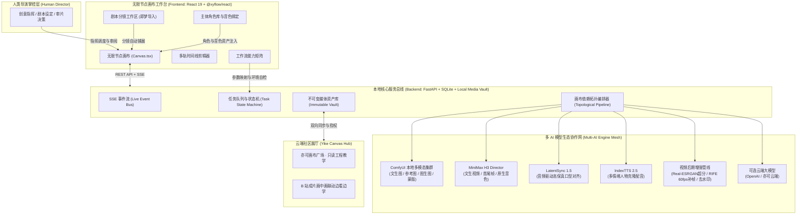

# ai-go-play

<div align="center">

[](LICENSE)
[](https://www.python.org/)
[](https://nodejs.org/)
[](https://react.dev/)
[](https://fastapi.tiangolo.com/)
[](https://github.com/comfyanonymous/ComfyUI)
[](CONTRIBUTING.md)

**AI to AI 协同创作工作台 · 人作为观众与领导，指挥 AI 协作完成影视级创作**

[English](README_EN.md) · [简体中文](README.md) · [贡献指南](CONTRIBUTING.md) · [更新日志](CHANGELOG.md)

</div>

---

## 🌟 核心理念：AI to AI 协同创作

在传统的 AIGC 创作中，人类往往陷入繁琐的单点提示词调试、平台间反复切图、手动对齐音频口型以及处理剪辑拼接的“数字苦力”中。

**ai-go-play** 提出了全新的创作范式：
> **「AI to AI 的创作方式，人作为观众，作为领导去指挥 AI 创作。」**

- **人作为导演与战略决策者**：创作者退居幕后，从宏观维度设定创意概念、剧本大纲、角色基调与最终视觉把控；
- **AI Agent 间自主编排与无缝流转**：剧本解析 AI 将故事切分为连续镜头；图像 AI 自主依据角色设定生成首尾关键帧；视频扩散 AI 依据时序推进镜头动作；音频与音色 AI 自主克隆语气与生成对白；口型 AI 精准同步人物唇形；后期增强 AI 自适应执行超分与插帧；
- **无限节点画布作为控制中枢**：全流程所有输入、依赖、候选版本、连线与生成结果在原位直观映射，数据流动透明，掌控尽在指尖。

---

## 🏛️ 系统架构 (Architecture)



---

## 🚀 核心功能特性

### 1. 🎨 无限节点素材与生成画布
- **自由空间与固定比例**：支持自由布局、16:9 横屏院线或 9:16 竖屏短剧画布。
- **不可变资产版本引用**：生成过程产生的图片、视频、音频均拥有独立的哈希快照版本，后续迭代绝不覆盖历史结果，随时一键回滚。
- **智能连线依赖高亮**：画布仅对实际发生参数或素材引用的连线进行智能流向高亮，右侧连出绝不反向误标，节点网络脉络清晰。
- **候选多版本对比**：单次生成多张候选图或多个视频片段，直接在卡片内左右切换对比并采纳。

### 2. 📜 AI 剧本分镜故事板（即梦一键导入）
- **即梦剧本格式原生兼容**：支持直接粘贴或导入从即梦等平台导出的结构化剧本与故事板 JSON。
- **长文本智能分镜拆解**：自动识别场次、景别（特写/中景/全景）、运镜轨迹、提示词、人物出场与对白。
- **画布自适应批量铺排**：一键将完整剧本在画布中自动排版为水平连续镜头卡片序列，支撑批量生图、生视频与流水线作业。

### 3. 🎬 视频后期增强全套管线
- **Real-ESRGAN / Anime6B 超分辨率放大**：一键将低分辨率或生图直接重建提升至 1080p / 4K 高清级别，消除模糊与噪点。
- **RIFE 4.6 深度学习补帧**：光流自适应插帧至流畅 60fps，大幅消除 AI 生成视频的动作卡顿、掉帧与微闪烁。
- **智能视频去水印**：利用时序空间上下文自适应消除固定角标与遮罩水印，保持原片质感。

### 4. 🗣️ 声音设计与高保真口型对齐
- **MiniMax H3 原生音色特征设计**：输入自然语言提示词（如“20岁清脆活泼少女音”、“磁性深夜电台主播音”），实时生成试听样本，一键绑定至项目主体角色。
- **IndexTTS 2.5 角色配音克隆**：支持参考音频声线克隆、中文台词定制、语速与情绪微调。
- **LatentSync 1.5 口型驱动同步**：音频驱动面部扩散，唇形毫秒级精准对齐多音节发音，完美保留角色原画皮肤肌理、五官发丝与光影连续性。

### 5. 🎞️ 多轨时间线自由剪辑
- 独立内置专业级多轨剪辑器：视频轨、音频轨、素材画中画轨、字幕轨一应俱全。
- 支持实时混音、关键帧缩放、转场预览与高质量 MP4 导出。

### 6. 🌐 亦可云端生态连接 (Yike Canvas Hub)
- **侧边栏左下角直观状态**：显示当前连接的亦可账号头像、昵称、在线状态微标；一键唤起管理菜单。
- **一键分享至画布广场**：将本地创作的完整节点工程发布为在线只读学习画布，向社区公开或通过私密链接分享。
- **B 站成片画中画边看边学**：将制作好的成片关联 B 站 BV 号，在线访客可打开画中画播放器，边看最终成片边对照学习底层节点与提示词。

---

## 🛠️ 快速安装与启动

### 环境准备
- **操作系统**：Windows 10 / 11（推荐环境）
- **Python**：Python 3.10 及以上（推荐 Python 3.12）
- **Node.js**：Node.js 20 及以上（推荐 Node.js 22 LTS）
- **媒体工具**：安装 [FFmpeg](https://ffmpeg.org/) 并将 `ffmpeg` 与 `ffprobe` 添加至系统 `PATH`。

### 1. 获取源码
```bash
git clone https://github.com/yoshino-xiao7/ai_go_play.git
cd ai_go_play
```

### 2. 初始化 Python 与前端环境
```powershell
# 1. 创建并激活虚拟环境
py -3.12 -m venv .venv
.\.venv\Scripts\Activate.ps1

# 2. 安装 Python 核心及开发依赖
python -m pip install --upgrade pip
python -m pip install -c requirements.lock -e ".[dev]"

# 3. 安装前端依赖并构建生产产物
npm --prefix frontend ci
npm --prefix frontend run build
```

### 3. 一键启动
在项目根目录中，你可以选择以下任一方式启动服务：

- **桌面双击启动（静默无黑框）**：双击 `start.vbs` 或 `start.cmd`，自动在后台静默启动并在浏览器中打开 http://127.0.0.1:8765。
- **PowerShell 命令行启动**：
  ```powershell
  .\start.ps1
  ```
- **开发者控制台启动**：
  ```powershell
  .\.venv\Scripts\python -m manju serve --port 8765
  ```

---

## 📦 本地模型与 ComfyUI 配置指南

`ai-go-play` 采用即插即用的模块化适配架构。你可以按需准备本地模型与节点：

| 模块能力 | 所需服务与模型权重 | 配置说明 |
| :--- | :--- | :--- |
| **基础画布与资产管理** | 无需 GPU / 无需额外大模型 | 安装 Python + 前端构建后即可完整体验 |
| **ComfyUI 图像创作** | 本地 ComfyUI 实例 + SDXL / Flux / Qwen 图像模型 | 工作流页面支持导入 ComfyUI API 格式 JSON |
| **MiniMax H3 视频** | MiniMax H3 本地或云端推理端点 | 工作流中配置 H3 Director 对应参数与镜头组 |
| **视频后期超分/补帧** | ComfyUI 加载 `Real-ESRGAN`、`RIFE 4.6` 节点 | 自动检测 FFmpeg 及对应 Upscale / Interpolate 模型 |
| **LatentSync 1.5 口型** | `LatentSync 1.5` 权重 + Whisper 特征提取 | 放置于对应推理模型目录，工作流页可一键检测就绪状态 |
| **IndexTTS 2.5 配音** | IndexTTS 2.5 本地推理环境与 checkpoint 权重 | 支持独立环境隔离，工作流页提供可用性检测 |

---

## 🤝 贡献与社区共建

我们非常期待来自开源社区的贡献！无论是新模型适配、交互优化、Bug 修复还是文档改进：

1. 请先阅读完整的 [CONTRIBUTING.md](CONTRIBUTING.md) 了解开发规范与流程；
2. 在提交大型改动前，欢迎先发起 Issue 进行方案讨论；
3. 遵循 Conventional Commits 规范编写提交日志。

---

## 📄 开源许可证

本项目基于 [MIT 许可证](LICENSE) 开源。商业使用、二次开发均可自由进行，请保留版权声明。

---

<div align="center">
Made with ❤️ by the ai-go-play Community.
</div>
