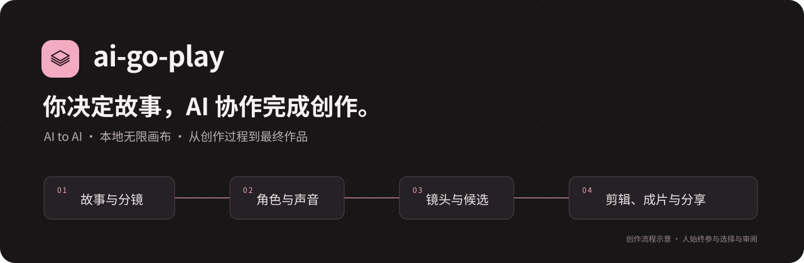
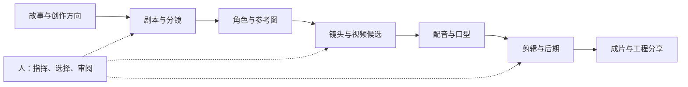
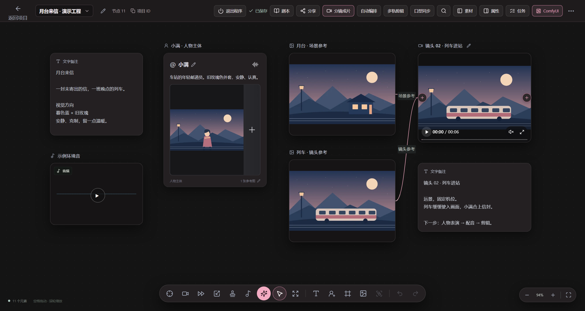
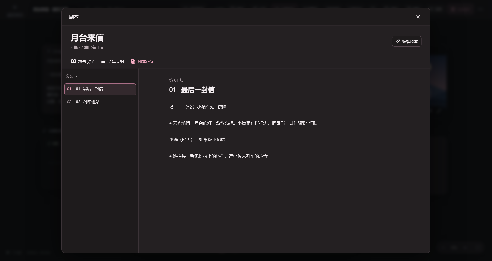
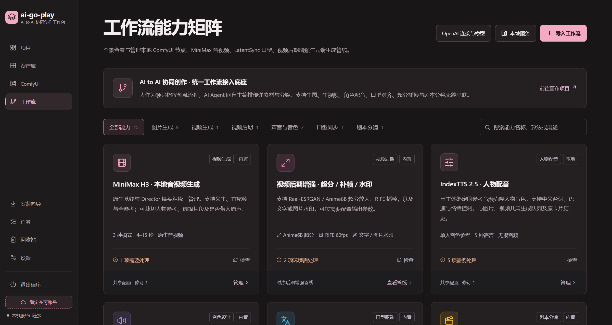
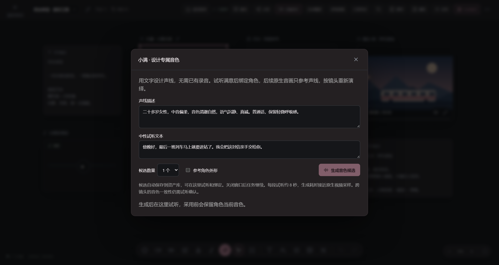
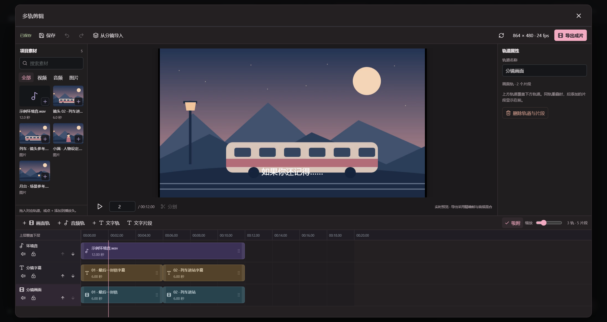
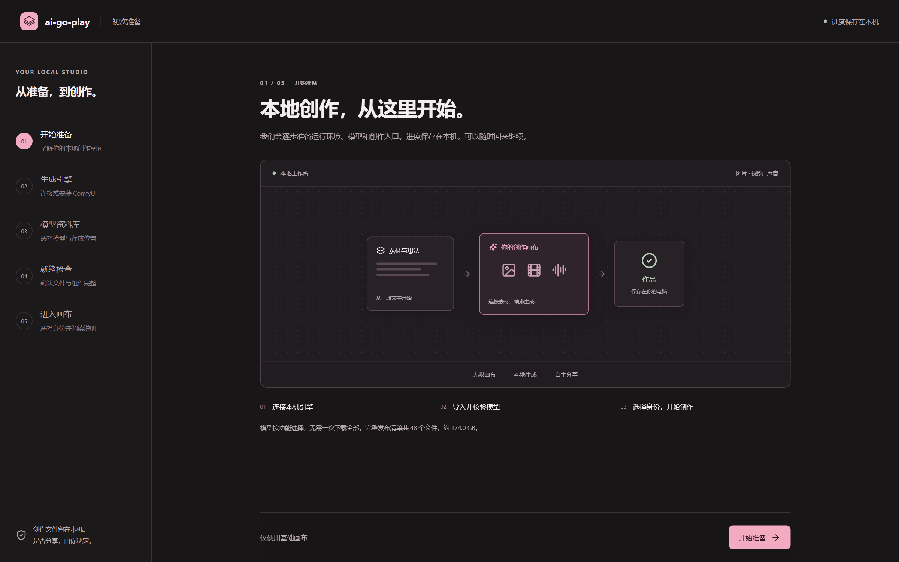
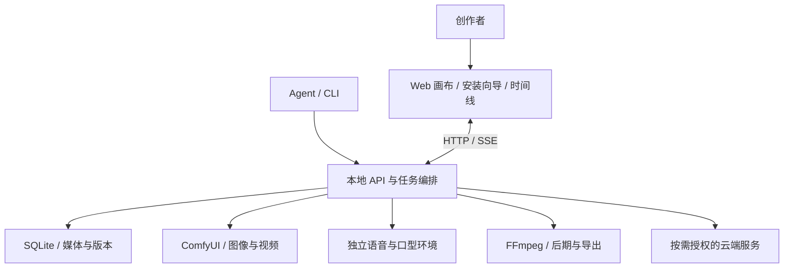
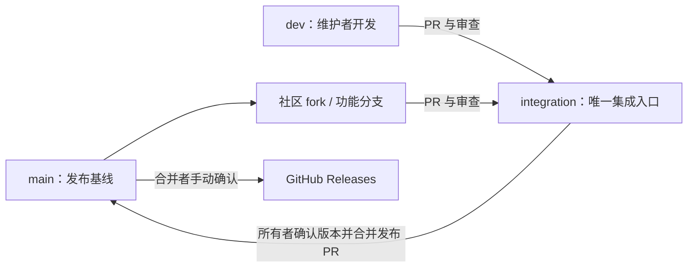

<p align="center"><b>简体中文</b> · <a href="README_EN.md">English</a></p>

<p align="center">
  
</p>

<p align="center">
  把故事、角色、镜头、声音和生成过程放在同一张无限画布上。<br>
  <b>人作为观众与导演，指挥 AI 协作，把想法一步步做成作品。</b>
</p>

<p align="center">
  <a href="LICENSE"></a>
  <a href="首次启动先看我.md"></a>
  <a href="CONTRIBUTING.md"></a>
  <a href="#community"></a>
</p>

<p align="center">
  <a href="首次启动先看我.md">开始使用</a> · <a href="docs/README.md">文档中心</a> ·
  <a href="https://github.com/yoshino-xiao7/ai_go_play/releases">版本发布</a> ·
  <a href="CONTRIBUTING.md">参与贡献</a> · <a href="#community">加入社区</a>
</p>

## 为什么做 ai-go-play

AI 已经能写剧本、画角色、生成视频、合成声音，但把这些能力组织成一部作品，仍需要反复切换工具、搬运文件、重写提示词和记录结果。一个镜头换了参考图，往往还要重新寻找声音、口型和剪辑所用的版本。

ai-go-play 希望把这些过程连接起来，让创作者更多地关注故事本身：这个人物是否成立，这段表演是否自然，这个镜头是否值得留下。

> **「AI to AI 的创作方式，人作为观众，作为领导去指挥 AI 创作。」**

这是项目的核心理念，也是持续建设的方向：

- **人决定方向。** 你设定故事、角色、风格和审片标准，决定采用哪些结果、哪些地方重做。
- **AI 分工协作。** Agent 可以通过同一套 API / CLI 编排剧本、素材、镜头和生成任务，模型各自完成图像、视频、声音及后期处理。
- **画布保留过程。** 提示词、参考连线、候选版本和生成结果留在项目中，让下一步创作有据可循，也方便复盘和教学。
- **本地掌握作品。** 资料库和创作工程保存在本机；按需连接 ComfyUI 和外部服务，云端授权与分享由用户选择。

当前已提供画布、生成工作流、任务编排、API / CLI 与 Agent 创作技能。AI 自动协作的范围取决于所用 Agent 和已准备的模型，生成结果仍需要人的选择与验收。

## 从一个故事，到一张可以继续创作的画布



例如制作一段双人对话：先确定角色和分镜，在画布中连接参考素材；为镜头生成多个候选，选定表演后准备角色配音，再处理口型、后期和时间线。某个镜头不满意时，可以保留已有候选，沿着原来的素材与提示词继续迭代。

### 无限画布，把素材和生成关系放在一起

图片、视频、声音、提示词和主体卡片在同一空间组织。参考关系通过连线表达，候选结果保留各自版本，便于对比和继续生成。保存、草稿恢复、项目导出与导入服务于持续创作，而不只保存最后一张图片。



### 剧本、角色和镜头，可以接着往下做

导入支持格式的剧本 / 故事板，整理分镜并铺到画布；通过主体库管理角色参考与音色，把角色信息用于后续镜头。既可以手动安排，也可以让 Agent 按项目技能操作画布，保留提示词、参考连线和生成记录。



### 图像与视频，在候选之间作选择

内置 Qwen Image、H3 图像及 H3 原生 / Director / Turbo 视频入口，支持对应模式的参考图、编辑、首尾帧和镜头参数。也可导入兼容的 ComfyUI API 工作流。每种模式需要对应模型和节点，工作流检查会提示缺失项。



### 声音与口型，沿着角色继续制作

用 H3 音色设计准备试听，用 IndexTTS 生成参考音色配音及情绪语音，再通过 LatentSync 处理音频驱动口型。语音与口型采用独立推理环境，由安装向导准备和检查依赖。效果取决于输入素材与模型，不把自动生成当作最终审片。



### 剪辑与后期，让片段成为作品

在多轨时间线中组织视频、音频和字幕，完成合成与导出；按需要使用 RIFE 插帧、超分或文字 / 图片水印。生成、后期和导出保留任务状态，失败时可定位到具体阶段。



### 创作过程，也可以分享给别人学习

按需绑定亦可账号，将工程分享为只读学习画布，并关联 B 站成片。观看作品时可以对照素材、连线和提示词，理解它是怎样做出来的。游客可以使用本地画布，账号用于需要授权的云端功能。

在本地「项目 → 从亦可导入」打开画布广场，复制公开作品链接，即可导入并打开可编辑的本地副本，也可先下载 `.manju` 项目包，之后在「导入项目」中打开。公开快照中的预览素材按分享时的画质导入。仅有封面、没有可下载文件的历史视频会跳过。继续创作前，请确认作者允许使用相关素材。

## 开始使用

**第一次使用，先看 [首次启动先看我.md](首次启动先看我.md) 或 [TXT 纯文本版](首次启动先看我.txt)。** 文档提供两条路径：把手册交给 Agent 协助安装，或自己照着步骤完成。

### Windows 一键启动

正式发布后从 [GitHub Releases](https://github.com/yoshino-xiao7/ai_go_play/releases) 下载版本 ZIP；开发期间使用完整源码。解压后双击根目录 **`start.cmd`**。

首次启动会打开准备页，自动准备项目需要的 Python、Node.js、FFmpeg 和依赖，随后进入 Web 安装向导。普通用户不需要先手动搭建开发环境。



1. **准备 ComfyUI。** 扫描并连接本机安装，或按向导下载、校验和安装。
2. **选择功能和模型。** 可按分类准备，也可选择全部模型；已有模型优先检查复用。
3. **下载并导入。** 从百度或夸克分享下载到本机，在向导中选择下载目录，导入默认或指定位置。
4. **检查是否就绪。** 完整校验 SHA-256，安装所需节点及语音 / 口型组件，按提示重启并检查。缺失模型会列出名称和下载入口。
5. **进入画布。** 选择亦可账号授权或游客，阅读并勾选隐私条款和用户手册。

暂时不准备模型，可以选择 **“仅使用基础画布”**，之后从安装向导继续。已有资料库和配置优先保留。

**退出时点击“退出程序 → 保存并退出程序”。** 关闭浏览器标签页不会关闭后台服务；保存失败或存在活动任务时，页面会提示先处理。由外部入口启动的 ComfyUI 需从其原入口停止。

### 环境与数据

| 项目 | 说明 |
| --- | --- |
| 自动安装平台 | Windows x64；其他平台的手动运行不等于已经验收支持 |
| 基础画布 | 不要求下载完整模型或具备推理 GPU |
| 本地生成 | 需要所选模型、节点及兼容的显卡 / 驱动，显存需求随模式与参数变化 |
| 网络 | 首次安装和模型下载需要联网；云端功能需要对应服务 |
| 模型空间 | 当前完整清单去重后约 174 GiB，可按功能选择；复制导入需额外预留空间 |
| 数据位置 | 新安装素材默认保存在用户目录 `ManjuData`，已有配置优先 |
| 工具与缓存 | 项目 `.manju` 目录；不属于作品备份 |

安装器不会自动修改显卡驱动。备份、升级和故障恢复见 [运维手册](docs/OPERATIONS.md)。

## 模型下载与功能选择

| 下载来源 | 提取码 |
| --- | --- |
| [百度网盘 · ai-go-play](https://pan.baidu.com/s/5nO-pzE6K3be3-t0zkpm1Pw) | 无需提取码 |
| [夸克网盘 · ai-go-play](https://pan.quark.cn/s/2ce0688209ca) | `BsXE` |

两处模型目录相同，任选其一下载即可。大文件请使用对应网盘客户端，保留原文件名和分类目录。

模型权重不包含在源码和 Release ZIP 内。下载后按向导导入统一模型目录，无需手动猜测每个节点的搜索路径。

| 功能包 | 用途 |
| --- | --- |
| 01-qwen-image | Qwen 文生图、参考图和编辑 |
| 02-h3-image | H3 图像与提示词增强 |
| 03-h3-video | H3 标准视频与音色设计 |
| 04-h3-turbo | H3 Turbo 视频及配套组件 |
| 05-indextts / 06-indextts-emotion | 角色配音、可选文本情绪 |
| 07-latentsync | 口型及依赖模型 |
| 08-video-enhance | 插帧、超分 |

包之间存在共享依赖，容量不能直接相加。准确文件、安装路径和完整性校验以 [模型清单](release/models.json)、[安装说明](release/模型下载与安装说明.txt)及 [SHA-256 清单](release/model-checksums.sha256) 为准。语音与口型另有 [从零安装手册](release/语音与口型从零安装.md)。

源码的 MIT 许可证不替代模型条款；部分模型对商业用途、分发或使用地区有条件。下载和使用前阅读 [模型来源与许可证](release/MODEL-LICENSES.md)，其中也记录了尚待确认的材料。

## 常见问题

<details>
<summary><b>一定要先下载全部模型吗？</b></summary>

不需要。可以先使用基础画布，再按图像、视频、语音、口型和后期选择功能包。模型准备好后回到向导检查即可。

</details>

<details>
<summary><b>已经有 ComfyUI 和模型，可以直接复用吗？</b></summary>

可以优先扫描连接和导入已有模型。向导会核对节点、指定模型文件及哈希；名称相同不代表内容相同。模型目录和组件变更后可能需要重启 ComfyUI。

</details>

<details>
<summary><b>AI to AI 是不是输入一句话就能自动完成整部作品？</b></summary>

这是项目探索的创作方向，当前能力是让 Agent 和模型在同一套画布与任务接口上协作。可自动完成多少取决于 Agent、技能、模型和项目要求；创作者仍需决定方向、选择候选并审阅成片。

</details>

<details>
<summary><b>必须登录吗？作品会自动上传吗？</b></summary>

游客可以使用本地画布，资料库保存在本机。账号授权、云端生成与工程分享是单独的操作；使用外部服务时，相关输入由该服务处理，分享前应检查内容和可见范围。

</details>

<details>
<summary><b>启动失败、模型缺失或无法保存，怎么反馈？</b></summary>

按 [支持指南](SUPPORT.md) 提供版本、环境、复现步骤和脱敏日志。保存失败时保持页面打开；不要先删除资料库、缓存或草稿。也可以到 QQ 群 455106785 交流。

</details>

## 技术架构与开发

React / TypeScript / React Flow 负责画布和 Web 向导；FastAPI 负责 API、任务及生命周期；SQLite 与本地媒体目录保存项目；ComfyUI 和独立桥接环境执行模型推理。



开发基准为 **Python 3.12、Node.js 22.12+、FFmpeg / FFprobe**。在 dev 或自己的任务分支工作，使用独立资料库与端口，避免开发操作影响创作项目。

```powershell
py -3.12 -m venv .venv
.\.venv\Scripts\python -m pip install -c requirements.lock -e ".[dev]"
npm --prefix frontend ci
npm --prefix frontend run build
.\.venv\Scripts\python -m manju serve --port 8780 --data-dir "$PWD\.qa\dev-data" --config-file "$PWD\.qa\dev-config.json"
```

热更新、检查命令及故障定位见 [开发环境](docs/DEVELOPMENT.md)、[架构](docs/ARCHITECTURE.md)、[API / CLI](docs/API.md) 和 [测试手册](docs/TESTING.md)。Agent 创作采用 **ai-go-play 创作技能集**，仅收录以下四个独立入口；上游技能原文、相对目录、素材与许可说明分别保存，不改写成统一制作规则。

| 技能 | 用途 |
| --- | --- |
| [ai-go-play-canvas](.agents/skills/ai-go-play-canvas/SKILL.md) | 本项目画布控制、固定素材、真实任务、分镜与时间线 |
| [ai-go-play-h3-official](.agents/skills/ai-go-play-h3-official/SKILL.md) | MiniMax-AI 官方 H3 视频提示词原版 |
| [ai-go-play-h3-enhancer](.agents/skills/ai-go-play-h3-enhancer/SKILL.md) | MushroomFleet 的 H3 提示词增强原版 |
| [ai-go-play-maimai](.agents/skills/ai-go-play-maimai/SKILL.md) | BenBenHS/maimai-tangtang 的动画制作与首帧两份原版技能 |

三个上游来源包均固定提交并记录逐文件校验值；在对应技能目录运行 `python scripts/source.py materialize`，校验后返回原版入口路径。技能包内的 `NOTICE.md` 与 `sources/manifest.json` 说明来源、许可和收录范围。

用户调用、独立安装、Windows 私有 Python 路径和完整性检查见 [创作技能使用手册](docs/AGENT_SKILLS.md)。

代码修改先阅读 [AGENTS.md](AGENTS.md)。

| 目录 | 内容 |
| --- | --- |
| `backend/manju/` | API、资料库、生成、任务和安装服务 |
| `frontend/src/` | 画布、时间线、主体库、工作流与 Web 引导 |
| `integrations/` | ComfyUI、自定义节点及独立推理桥接 |
| `scripts/` | 安装、自检、模型审计、文档校验和发布工具 |
| `tests/` | 自动化回归与治理检查 |
| `docs/` | 开发、架构、接口、审查、发布及运维手册 |
| `release/` | 模型清单、许可依据、验收记录与发布就绪状态 |
| `.github/` | PR / Issue 模板、质量检查、治理与 Release 工作流 |

## 贡献与版本发布

欢迎贡献模型适配、交互改进、缺陷修复、文档和真实环境验收。大型修改先说明问题与方案；普通贡献统一投向 **integration**。



- **社区贡献：** 从 main fork，开发后向上游 integration 提交 PR。
- **维护者开发：** 在 dev 开发，同样通过 PR 进入 integration。
- **版本发布：** 仅仓库所有者将本仓库 integration 合并到 main；合并者明确确认版本，再发布 GitHub Release。
- **错误目标：** 普通 PR 直接指向 main / dev 会被流程拒绝，说明原因并引导改投 integration。

不直接推送 main / integration，不用标签代替 Release。审核绑定当前提交，新增提交须重新确认。详见 [贡献指南](CONTRIBUTING.md)、[治理规范](docs/GOVERNANCE.md) 和 [发布手册](docs/RELEASING.md)。

<a id="community"></a>

## 社区与反馈

**QQ 交流群：`455106785`**，在 QQ 中搜索群号加入。欢迎交流创作流程、分享使用经验，也欢迎带着复现步骤一起定位问题。

- 功能建议与缺陷：[GitHub Issues](https://github.com/yoshino-xiao7/ai_go_play/issues)。
- 提交代码与文档：[CONTRIBUTING.md](CONTRIBUTING.md)。
- 安装、日志和问题模板：[SUPPORT.md](SUPPORT.md)。
- 敏感问题：[SECURITY.md](SECURITY.md)，不要公开令牌、私人素材或数据库。

## 许可证与致谢

项目源码采用 [MIT](LICENSE)。第三方代码、模型与素材适用各自条款；来源、许可原件和待确认事项集中在 [模型许可说明](release/MODEL-LICENSES.md) 与 [NOTICE](release/NOTICE.txt)。

感谢 ComfyUI 及节点生态、React Flow、FastAPI、FFmpeg，以及图像、视频、语音和口型模型的开发者。相关项目的名称与标识归各自所有者，不代表其对本项目的背书。

<p align="center"><b>把重复操作交给 AI，把创作方向留给你。</b></p>
