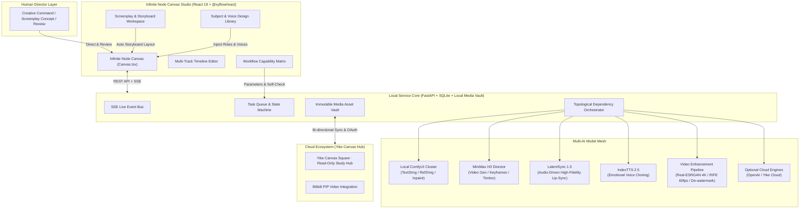

# ai-go-play

<div align="center">

[](LICENSE)
[](https://www.python.org/)
[](https://nodejs.org/)
[](https://react.dev/)
[](https://fastapi.tiangolo.com/)
[](https://github.com/comfyanonymous/ComfyUI)
[](CONTRIBUTING.md)

**AI-to-AI Collaborative Studio · Humans act as the audience and director to command AI creation**

[English](README_EN.md) · [简体中文](README.md) · [Contributing Guide](CONTRIBUTING.md) · [Changelog](CHANGELOG.md)

</div>

---

## 🌟 Core Philosophy: AI to AI Collaborative Creation

In conventional AIGC workflows, human creators are often bogged down by monotonous parameter tweaking, manual image slicing between siloed platforms, tedious audio-lip alignment, and manual timeline editing.

**ai-go-play** pioneers an innovative paradigm:
> **"An AI-to-AI creation methodology: Humans act as the audience and visionary leader to command and direct AI creation."**

- **Human as Director & Strategic Decision Maker**: Creators step back to the executive director's chair—shaping narrative themes, screenplay outlines, artistic direction, and qualitative critique.
- **Autonomous Multi-Agent Chaining & Hand-off**:
  - The Screenplay Agent decomposes the story into coherent scene storyboards;
  - Image diffusion models synthesize character sheets and keyframes;
  - Video diffusion models animate temporal action and camera motion;
  - Voice Agents design acoustic timbres and clone emotional speech;
  - Lip-sync diffusion models achieve frame-accurate phoneme alignment;
  - Video enhancement pipelines handle super-resolution upscaling and 60fps frame interpolation.
- **Infinite Node Canvas as Mission Control**: All dependencies, parameter routes, candidates, and multi-version assets flow transparently on an infinite canvas with live execution tracking.

---

## 🏛️ System Architecture



---

## 🚀 Key Features

### 1. 🎨 Infinite Node Canvas & Immutable Vault
- **Freeform & Constrained Aspect Ratios**: Freely pan and zoom, or constrain frames to cinematic 16:9 or vertical 9:16 aspect ratios.
- **Immutable Asset Versioning**: Every generation creates a SHA-256 snapshotted version. Iterations never silently overwrite past work, enabling instantaneous version rollback.
- **Intelligent Edge Highlighting**: The canvas highlights connection paths only when actual downstream parameters or assets reference them—edges extending from node outputs never cause false reverse highlights.
- **Candidate Review**: Generate multiple candidates in a single pass; compare and adopt versions directly on the node card.

### 2. 📜 AI Screenplay Storyboard (Jimeng Format Import)
- **Jimeng Format Native Support**: Import structured screenplay JSON or text exported from platforms like Jimeng with zero manual formatting.
- **Intelligent Scene Decomposition**: Automatically detects scenes, camera shots (close-up, wide shot), camera motion, descriptions, character appearances, and dialogue lines.
- **Canvas Auto-Layout**: One-click layout expands the entire screenplay into a sequential horizontal timeline of canvas shot cards for batch generation.

### 3. 🎬 Video Post-Processing Enhancement Pipeline
- **Real-ESRGAN / Anime6B Super-Resolution**: Upscale low-res generation or 720p footage to crisp 1080p / 4K with edge refinement and noise suppression.
- **RIFE 4.6 Deep Learning Frame Interpolation**: Optical-flow motion interpolation elevates 24fps AI video to silky 60fps, mitigating micro-stuttering and temporal artifacts.
- **Temporal Video De-watermarking**: Automatically erase watermarks or corner logos leveraging spatio-temporal context filling.

### 4. 🗣️ Acoustic Voice Design & Precision Lip-Sync
- **MiniMax H3 Native Voice Design**: Define unique character timbres via natural language descriptions (e.g., *"20-year-old bright energetic girl voice"*, *"deep textured radio narrator"*), audition samples, and bind the timbre to character nodes.
- **IndexTTS 2.5 Voice Cloning**: Clone voices from reference audio with fine control over Chinese/English dialogue cadence and emotional tone.
- **LatentSync 1.5 Diffusion Lip-Sync**: End-to-end audio diffusion drives facial movements, achieving millisecond phoneme alignment while preserving original facial identity, lighting, and hair textures.

### 5. 🎞️ Multi-Track Timeline Editor
- Built-in multi-track non-linear editor featuring video, audio, picture-in-picture, and subtitle tracks.
- Live volume mixing, keyframe scaling, transition preview, and production MP4 rendering.

### 6. 🌐 Yike Cloud Ecosystem (Canvas Hub)
- **Live Account Status in Sidebar**: Displays the connected Yike user avatar, nickname, and live status badge with an account popover.
- **One-Click Publish to Canvas Square**: Share complete canvas projects as read-only interactive tutorials publicly or via private link.
- **Bilibili Picture-in-Picture Study**: Bind published canvases to Bilibili video BV numbers. Visitors can watch the final video in a floating PIP player while analyzing node parameters and prompts in real-time.

---

## 🛠️ Quick Start & Installation

### Prerequisites
- **Operating System**: Windows 10 / 11 (Recommended)
- **Python**: Python >= 3.10 (Python 3.12 Recommended)
- **Node.js**: Node.js >= 20 (Node.js 22 LTS Recommended)
- **Media Tools**: [FFmpeg](https://ffmpeg.org/) installed with `ffmpeg` and `ffprobe` in system `PATH`.

### 1. Clone Repository
```bash
git clone https://github.com/yoshino-xiao7/ai_go_play.git
cd ai_go_play
```

### 2. Setup Python Environment & Frontend
```powershell
# 1. Create and activate Python virtual environment
py -3.12 -m venv .venv
.\.venv\Scripts\Activate.ps1

# 2. Install Python core and dev dependencies
python -m pip install --upgrade pip
python -m pip install -c requirements.lock -e ".[dev]"

# 3. Install frontend dependencies and build production bundle
npm --prefix frontend ci
npm --prefix frontend run build
```

### 3. Launching ai-go-play
Choose any of the following methods from the project root:

- **Desktop Double-Click (Windowless Silent Mode)**: Double-click `start.vbs` or `start.cmd`. It launches the background server and opens http://127.0.0.1:8765 in your browser without command prompt windows.
- **PowerShell CLI**:
  ```powershell
  .\start.ps1
  ```
- **Developer Debug Mode**:
  ```powershell
  .\.venv\Scripts\python -m manju serve --port 8765
  ```

---

## 📦 Model & Service Compatibility Matrix

`ai-go-play` is built on a plug-and-play modular architecture:

| Capability | Requirements & Weights | Setup Notes |
| :--- | :--- | :--- |
| **Canvas & Asset Vault** | No GPU or weights needed | Ready immediately after Python & frontend build |
| **ComfyUI Image Gen** | Local ComfyUI instance + SDXL / Flux / Qwen | Import ComfyUI API-format JSON in Workflows tab |
| **MiniMax H3 Video** | Local or remote MiniMax endpoint | Configure H3 Director settings in Workflows tab |
| **Video Enhancement** | ComfyUI with `Real-ESRGAN` & `RIFE 4.6` nodes | Automatically checks FFmpeg and upscale models |
| **LatentSync 1.5 Lip-Sync** | `LatentSync 1.5` weights + Whisper feature extractor | One-click readiness diagnostics in Workflows tab |
| **IndexTTS 2.5 Voice** | IndexTTS 2.5 Python runtime and checkpoints | Isolated environment supported, validated in UI |

---

## 🤝 Community & Contributing

We welcome contributions of all kinds! Whether it's integrating new model adapters, UI/UX polish, bug fixes, or documentation:

1. Read our [CONTRIBUTING.md](CONTRIBUTING.md) for code standards and git workflow.
2. Open an Issue first before submitting large architectural changes.
3. Follow the Conventional Commits specification for commit messages.

---

## 📄 License

This project is licensed under the [MIT License](LICENSE). Commercial and personal usage are freely permitted with copyright attribution.

---

<div align="center">
Made with ❤️ by the ai-go-play Community.
</div>
