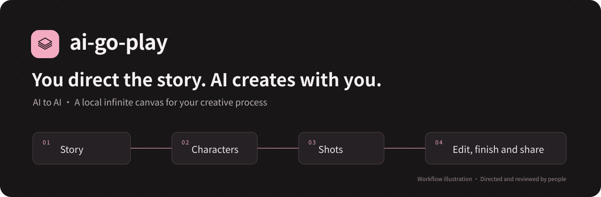
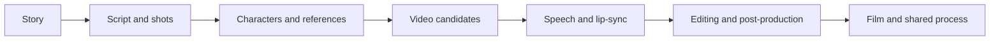
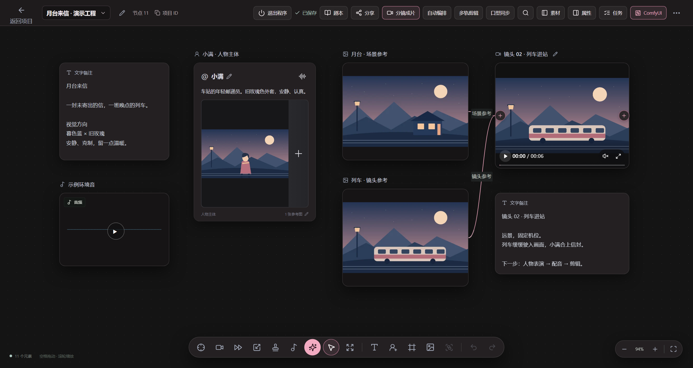
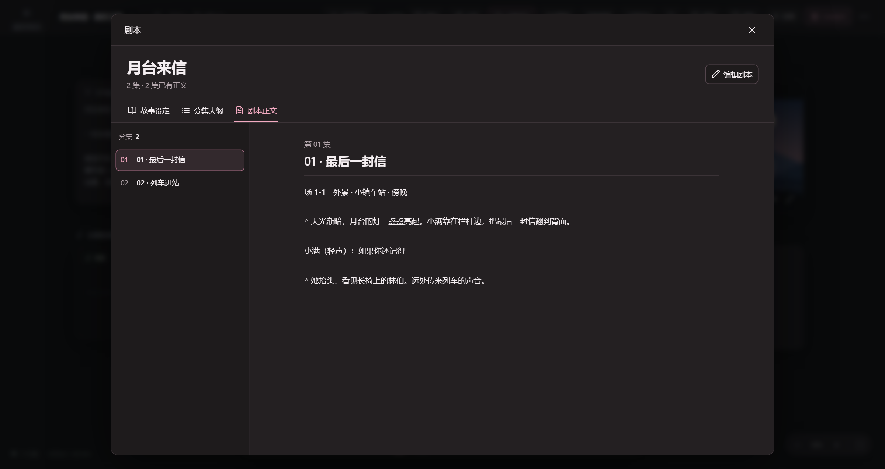
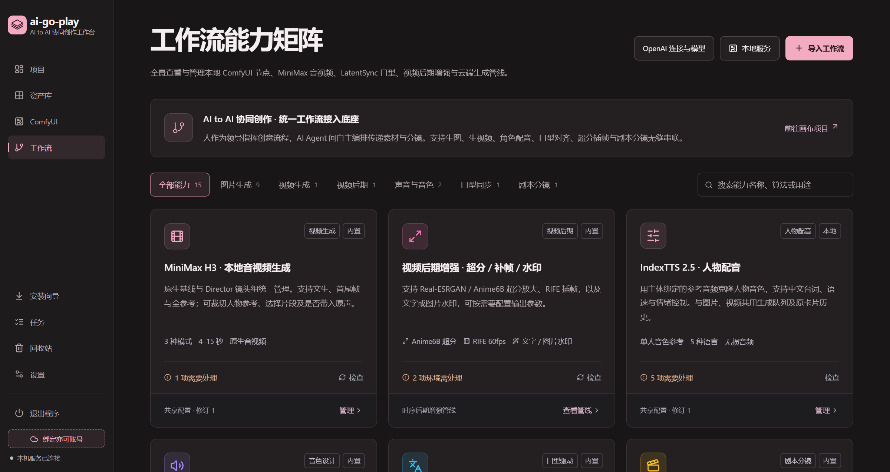
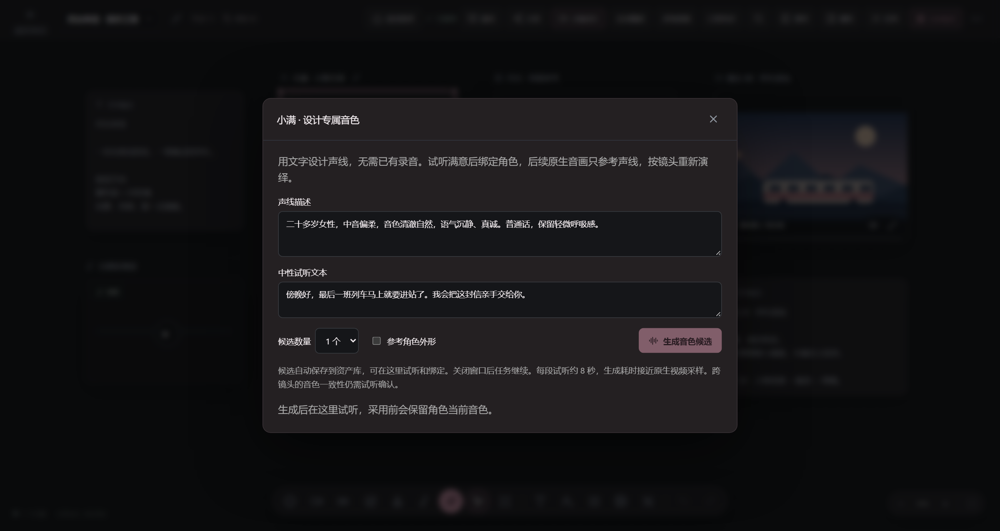
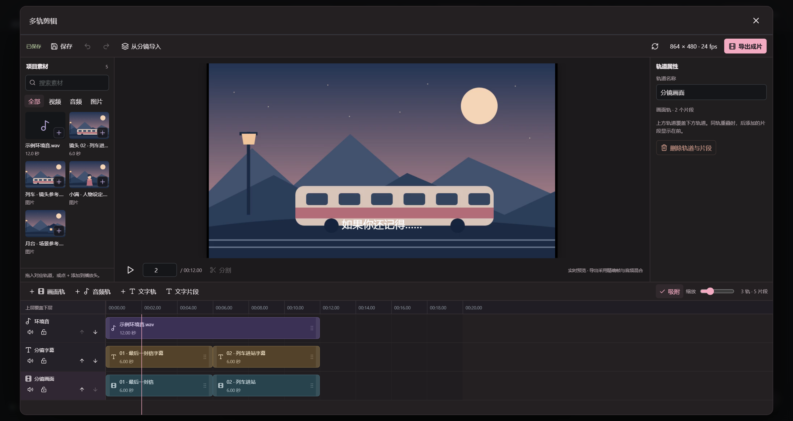
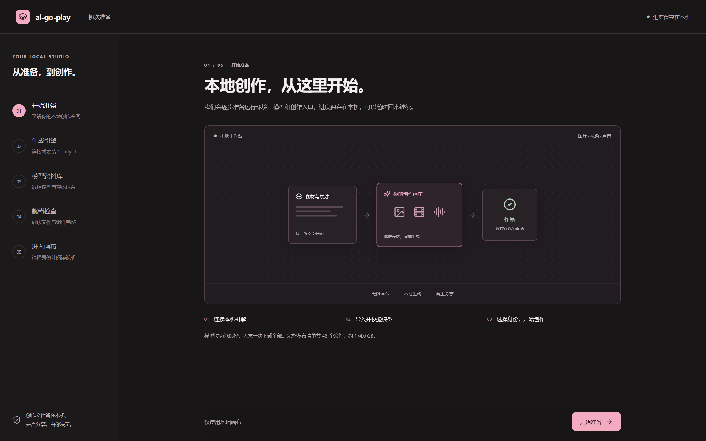

<a href="README.md">简体中文</a> · <b>English</b>

Stories, characters, shots, voices and generation history on one infinite canvas. <b>People direct and review. AI agents and models create together.</b>

  
  
  
  

<a href="首次启动先看我.md">Get started</a> · <a href="docs/README.md">Documentation</a> · <a href="https://github.com/yoshino-xiao7/ai_go_play/releases">Releases</a> · <a href="CONTRIBUTING.md">Contribute</a> · <a href="#community">Community</a>

## Why ai-go-play exists

AI can write a script, draw a character, animate a shot and generate a voice. Turning those outputs into a coherent work still involves moving files between tools, rewriting prompts and tracking which version belongs to which shot.

ai-go-play connects that process so creators can spend more time deciding whether a character works, a performance feels right or a shot belongs in the story.

> **AI-to-AI creation: people act as the audience and director, guiding AI collaboration.**

- **People set the direction.** Define the story, characters, style and review criteria. Choose what to keep and what to redo.
- **Agents and models share the work.** The same local API and CLI support asset preparation, shot planning and generation tasks.
- **The canvas preserves the process.** Prompts, references, candidates and results stay connected for iteration, review and teaching.
- **Projects stay under local control.** Media and project data live on your machine; external services and sharing are optional, separately authorized operations.

The workspace already provides canvas editing, generation workflows, orchestration, API / CLI access and agent skills. The amount of automation depends on the agent, models and task; creative judgment and final acceptance remain human responsibilities.

## From a story to a working canvas

For a two-person scene, establish characters and shots, connect references, generate candidates and choose the performances. Add character voices and lip-sync, then compose the timeline. Rework an unsatisfactory shot while preserving its earlier candidates and inputs.

### Keep assets and generation relationships together

Organize images, video, audio, prompts and subject cards in one space. Reference links and versioned candidates make iteration traceable. Saving, draft recovery and project import/export support ongoing work.

### Carry scripts and characters into the next shot

Import supported scripts or storyboards, arrange shots on the canvas and manage character references and voices. Work manually or let an agent use the project skills while preserving prompts and references.

### Choose between image and video candidates

Built-in entries cover Qwen Image, H3 image and H3 native / Director / Turbo video. Available inputs depend on the mode, including references, editing, keyframes and camera controls. Compatible ComfyUI API workflows can also be imported.

### Develop voices and lip-sync with the character

H3 voice design produces samples; IndexTTS provides reference-voice and emotional speech; LatentSync handles audio-driven lip-sync. Setup prepares separate inference environments. Results still need review against the source material.

### Turn clips into a finished sequence

Arrange video, audio and subtitles in the timeline, compose and export, and apply interpolation, upscaling or text/image watermarks as needed. Task states help identify where a failure occurred.

### Share how the work was made

An optional Yike account connects projects to read-only learning canvases and associated Bilibili films. Viewers can compare the final work with its references and prompts. Guest mode remains available for local canvas use.

## Install and run

1. After a release is published, download and extract its ZIP asset. During development, clone the complete repository.
2. On Windows x64, double-click `start.cmd`. It prepares the environment and opens Web setup.
3. Connect or install ComfyUI, download and import selected model packs, and run the full checksum check. Basic canvas use does not require models.
4. Complete identity selection and personally review the privacy policy and manual.
5. Select **退出程序 (Exit application)** and **保存并退出程序 (Save and exit)** to stop the application. Closing the browser alone does not stop its backend.

The [first-run guide](首次启动先看我.md), also available as [plain text](首次启动先看我.txt), can be handed to an agent. Automatic setup is validated on Windows x64. Other systems and GPU configurations are not equivalent to a tested supported installation. Drivers are not changed automatically.

Model mirrors: [Baidu Netdisk](https://pan.baidu.com/s/5nO-pzE6K3be3-t0zkpm1Pw) (no extraction code) or [Quark](https://pan.quark.cn/s/2ce0688209ca) (code `BsXE`). Both use the same model folder layout; choose one source and use its desktop client for large files. The full manifest is about 174 GiB; install only needed packs. Source and Release ZIPs do not contain weights. Read the [model license review](release/MODEL-LICENSES.md) and verify downloads against the fixed SHA-256 manifest.

## Development policy

| Source | Allowed PR target | Approval |
| --- | --- | --- |
| Maintainer dev | integration | Owner confirmation of the current head SHA |
| Community fork of main, with a feature branch | integration | Owner confirmation of the current head SHA |
| This repository's integration | main | Owner-opened and owner-merged release PR with explicit version confirmation |

Ordinary PRs targeting main or dev are rejected with an explanation. Do not push directly to main or integration. After a release PR is merged, the merger manually confirms its version in the GitHub Release workflow. A tag alone is not a release.

Read [governance](docs/GOVERNANCE.md), [development](docs/DEVELOPMENT.md), [testing](docs/TESTING.md), and [releasing](docs/RELEASING.md).

## Frequently asked questions

<b>Do I need all the models?</b>

No. Start with the basic canvas, then prepare the image, video, speech, lip-sync or post-production packs you need. Packs share dependencies; their sizes cannot simply be added together.

<b>Can I reuse an existing ComfyUI installation?</b>

Setup can scan and connect an existing instance and import models. It checks required nodes and file hashes; matching filenames alone do not prove compatibility. Model-path and component changes may require a ComfyUI restart.

<b>Does AI-to-AI mean a whole film from one prompt?</b>

It describes the project's direction. Current tools let agents and models collaborate through a shared canvas and task interface. The creator still directs, chooses candidates and reviews the final result.

<b>Is an account required?</b>

Guest mode supports local canvas work. Account authorization, cloud generation and sharing are separate operations. External services process the inputs sent to them; review content and visibility before sharing.

## Architecture and support

React / TypeScript / Vite / React Flow provide the UI. A loopback FastAPI service coordinates SQLite metadata, media and tasks. ComfyUI and isolated bridges provide inference. See [architecture](docs/ARCHITECTURE.md) and [API / CLI](docs/API.md).

Use [SUPPORT.md](SUPPORT.md) for issues and [SECURITY.md](SECURITY.md) for sensitive disclosures. Never attach credentials, private media, databases or unredacted logs.

Source is [MIT licensed](LICENSE). Models and upstream components retain their own licenses; source-code publication does not grant unrestricted model use or redistribution.

## Community

**QQ group: `455106785`** — search for this group number in QQ. Share creative workflows, installation experience and reproducible problems.

Report bugs and proposals in [GitHub Issues](https://github.com/yoshino-xiao7/ai_go_play/issues); follow [CONTRIBUTING.md](CONTRIBUTING.md) for code or documentation. Detailed manuals are currently maintained in Chinese. Sensitive reports follow [SECURITY.md](SECURITY.md).

Thanks to the ComfyUI ecosystem, React Flow, FastAPI, FFmpeg and the developers of the integrated models.
