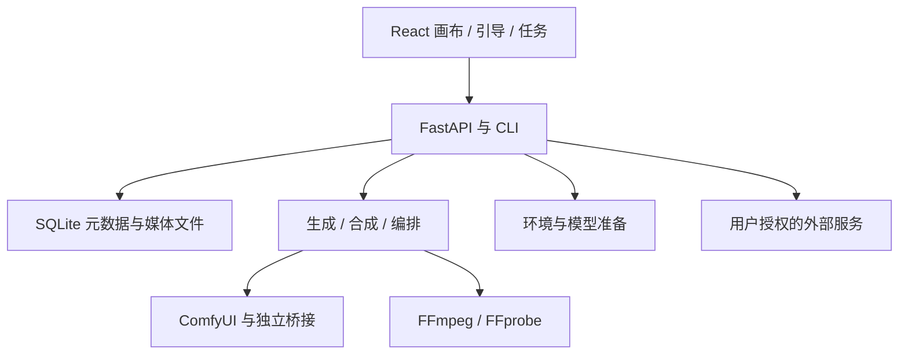

# 系统架构

## 边界

工作台后端默认监听回环地址，浏览器通过 HTTP API / SSE 通信。素材、元数据与创作状态保存在本机；分享和云端生成是需要用户授权的独立交互。

## 模块

| 责任 | 位置 |
| --- | --- |
| API、异常和生命周期 | backend/manju/app.py、cli.py、system_api.py |
| 事务、版本、资料库锁 | store.py、schema.sql、media.py |
| 任务提交与结果回收 | generation.py、workflows.py、模型适配器 |
| 镜头、画布与时间线编排 | orchestration.py、production.py、timeline.py |
| 首次准备与模型校验 | setup_*.py、scripts/bootstrap*、scripts/local_ai/ |
| 前端画布与异步草稿 | frontend/src/Canvas.tsx、canvasDraftStore.ts |
| 外部账号与云端生成 | share.py、openai_images.py |

首次启动细节见 [引导架构](../release/首次启动架构.md)。

## 不变量

- 新资产版本不覆盖历史素材，节点和导出引用明确版本。
- 画布保存携带 revision / request ID；冲突保留修改，不静默覆盖。
- 草稿异步持久化，大画布拖动避免同步序列化全图。
- 队列存在、执行成功、结果回收和用户验收是不同事实。
- 停止 ComfyUI 必须验证进程归属，不能停止外部未知进程。
- 安装导入防止路径逃逸，文件大小匹配不代表内容哈希一致。
- 源码许可不覆盖模型和转换权重的许可。

新增模型同时评估节点契约、固定来源、模型位置、依赖和许可；新增任务设计取消、恢复及幂等；跨模块变更在 PR 中说明兼容性与回退。
