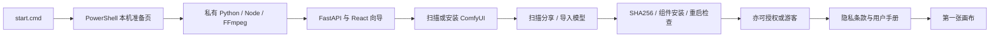

# 首次启动与 Web 安装向导

## 用户入口

根目录 `start.cmd` → 隐藏的 `start.vbs` / `start.ps1` → 浏览器准备页 → Web 向导 → 画布。Windows x64 用户不需要先安装 Python、Node.js、Git 或 FFmpeg；下载完整源码压缩包也可以启动。

## 模块边界

| 层 | 实现 | 职责 |
| --- | --- | --- |
| 启动宿主 | `scripts/bootstrap*.ps1`、`bootstrap.html` | Python 尚未安装时提供仅监听本机的进度页、重试入口 |
| 项目环境 | `scripts/bootstrap_core.py` | 私有工具链、依赖锁、前端构建指纹、FFmpeg |
| 向导协调 | `backend/manju/setup_service.py`、`setup_api.py` | 配置、步骤、能力检查、同意记录、进入画布 |
| 安装任务 | `setup_jobs.py`、`setup_install.py` | 单任务、持久状态、取消、固定下载源、子进程日志与恢复 |
| 模型文件 | `setup_catalog.py`、`setup_models.py` | 发布清单、公开分享核对、非覆盖复制、SHA256 校验 |
| 功能就绪 | `setup_readiness.py`、`comfyui_manju_setup` | 真实节点及模型枚举、实际重启版本回执 |
| Web 界面 | `frontend/src/setup/useOnboarding.tsx`、五个 `*Step.tsx` | 状态与交互集中在 hook；每一步独立展示；画布延迟加载 |

## 状态和文件

- 引导状态与任务记录保存在当前配置文件旁的 `.setup` 目录，与素材数据库分开。浏览器刷新只读取已有任务，不重复启动安装。
- 模型默认 `用户目录/ManjuModels`，新 ComfyUI 默认 `用户目录/ManjuApps/ComfyUI_windows_portable`，均可在 Web 修改。
- 工具链、下载缓存与独立推理环境位于项目 `.manju`，已有资料库设置保持原样。准备期间再次启动会复用已有进度页。
- 模型清单固定文件名、大小和 SHA256；在线分享只核对名称与大小，不替代本地内容校验。
- 清单提供共享文件的网盘目录；在线扫描成功时优先显示实际位置。安装检查节点在 ComfyUI 启动时读取自己的模型目录配置，使外部启动入口也能加载自定义路径，不覆盖用户的路径配置。
- 导入只复制：临时文件校验成功才发布，冲突不覆盖，取消保留已完成文件。目标目录中的外部链接会被拒绝。
- 更改模型分类或目标路径会清除旧校验；最终进入时再次检查文件大小及修改时间，防止使用过期结果。

## 安装和重试

官方便携版和第三方节点源码按 URL、版本/提交、SHA256 固定在 `setup-sources.json`。补充节点依赖时约束已有 Torch、TorchVision、TorchAudio 和 NumPy，避免替换原有 CUDA 栈。Goohai 只补充项目 Qwen 编码器需要的依赖，其余未使用节点不保证可运行。

语音与口型保留独立 Python 3.11 推理环境；ComfyUI 只安装桥接所需的轻量依赖。Turbo 对向导提供的 PyTorch 2.14 / CUDA 13 便携版补齐固定 SageAttention、Triton 和 Python 开发文件，并执行 CUDA 与 Triton JIT 运算检查。已有特殊环境无法匹配时会停止并说明原因，不强制升级 Torch。

安装前确认队列空闲；由项目托管的引擎自动停止并重启，外部引擎需从其原入口重启。安装完成写入新版本回执，只有运行中的 ComfyUI 实际加载该回执才通过检查。任务中断后标记为可重试；记录的安装子进程按 PID、创建时间、可执行文件和命令行核对后清理。

## 账号与联网边界

夸克分享目录使用公开分享接口读取，不读取用户浏览器登录信息。实际下载在夸克官方页面进行，下载完成后回到向导导入本机目录。接口失败时仍可按项目内置清单下载、导入和校验。

亦可沿用现有官方网页授权流程，支持在那里注册或登录，本地页面不收集密码。游客无需账号。隐私条款和用户手册均默认未勾选；后端核对两项同意和说明版本，再允许完成。账号授权需真实用户完成；自动化验收不会替用户注册账号。

所有本机 API 沿用项目的 Host / Origin 防护。引导页首次准备宿主也限制为 loopback，并对重试请求检查来源与随机令牌。

## 验收范围

机器与环境证据见 `setup-validation.json`；语音、口型从零环境的独立验收见 `local-ai-validation.json`。这些是具体机器上的实测记录，不表示所有显卡和驱动组合都已验收。教学视频待这些安装流程稳定后再制作。
